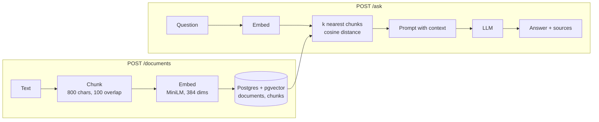

# doc-qa-rag

**Ask questions about your own documents and get answers with sources.** A small, tested RAG service: async FastAPI, Postgres with pgvector, SQLAlchemy 2.0 and Alembic.

   

## Why this exists

I built this to get hands-on with the pieces of a modern Python backend that I had not used at work: **asyncio, an ORM with schema migrations, and vector search in Postgres**. At work I run LLM agents in production at a bank, here I wanted to build the retrieval side end to end in a small, readable codebase.

It is a **study project, not a production system**, and the [limits](#known-limits-and-next-steps) are listed on purpose. It was built pair programming with Claude Code.

## What it does



1. **Index:** send a text. It is split into overlapping chunks, each chunk is embedded, and the document with all its chunks is saved in **one transaction** (all or nothing).
2. **Ask:** the question is embedded, pgvector returns the k closest chunks, and the LLM answers using only that context, citing the sources.

### Example

```bash
curl -X POST localhost:8000/documents -H "Content-Type: application/json" -d '{
  "title": "it-help",
  "content": "If you forgot your login credentials, use the recovery link on the sign in page. A reset email is sent in up to 5 minutes and the link expires after 24 hours."
}'
# {"id": 1, "title": "it-help", "chunks": 1}

curl -X POST localhost:8000/ask -H "Content-Type: application/json" -d '{
  "question": "How long is the password reset link valid?", "k": 1
}'
```

```json
{
  "answer": "The password reset link is valid for 24 hours. [1]",
  "sources": [
    {
      "document_id": 1,
      "position": 0,
      "text": "If you forgot your login credentials, use the recovery link on the sign in page. ...",
      "distance": 0.356
    }
  ]
}
```

The question and the document share almost no words ("reset" vs "recovery link"), which is the point of semantic search. A minimal page at `/` lets you add documents and ask questions from the browser.

## Quick start

Requirements: Python 3.12, Docker, and an API key from any OpenAI compatible provider (Groq has a free tier).

```bash
git clone https://github.com/tutorres/doc-qa-rag.git && cd doc-qa-rag
docker compose up -d                       # Postgres with pgvector

python -m venv .venv
source .venv/bin/activate                  # Windows: .venv\Scripts\activate
pip install -r requirements.txt

cp .env.example .env                       # then set LLM_API_KEY and LLM_MODEL
alembic upgrade head                       # creates the extension and the tables
uvicorn app.main:app --reload
```

Open http://localhost:8000. The first question downloads the embedding model (about 90 MB).

## Design decisions

| Decision | Why |
|---|---|
| **Single transaction** for a document and its chunks | A crash halfway never leaves a document with only part of its chunks. |
| **Embedding runs in a thread** (`run_in_executor`) | It is CPU bound. Run directly inside an async function it would block the event loop and freeze every other request. |
| **Embedder and LLM behind small interfaces**, injected with FastAPI dependencies | Tests swap in fakes, and the LLM provider is just configuration (`LLM_BASE_URL`, `LLM_MODEL`). |
| **`expire_on_commit=False`** on the async session | Avoids a hidden lazy reload after commit, which fails in async code. |
| **Alembic for the schema**, first migration enables the `vector` extension | The schema is versioned and reproducible, and the extension exists before the tables that need it. |
| **Overlapping chunks** | A sentence cut at a chunk border still appears whole in one of them. |

## Tests

```bash
docker compose exec db psql -U docqa -d docqa -c "CREATE DATABASE docqa_test"
pytest
```

The suite runs against a **real Postgres** (`docqa_test`) with a fake embedder and a fake LLM, so it needs no network and no API key. It covers chunking, validation, the empty case, and a retrieval test that checks the most relevant chunk is returned and that the context reaches the LLM.

## Project layout

```
app/
  main.py         routes and dependencies
  models.py       Document and Chunk (SQLAlchemy 2.0, pgvector column)
  db.py           async engine and session dependency
  rag.py          chunking, nearest neighbor search, prompt
  embeddings.py   real (sentence-transformers) and fake embedders
  llm.py          OpenAI compatible client and a fake
  static/         minimal web page
migrations/       Alembic
tests/            pytest with a real database
```

## Known limits and next steps

- **No vector index.** The search scans every chunk. Next: an HNSW index as a second migration.
- **No idempotency.** A client retry after a lost response stores the same document twice. Next: an idempotency key or a content hash with a unique constraint.
- **Indexing runs inside the request.** Next: a queue and a worker.
- **No evaluation of retrieval quality.** Next: recall@k over a small set of questions with reference answers.
- Chunking is by characters, plain text only (no PDF), no auth, no pagination, no reranking.

## Stack

Python 3.12 · FastAPI · Pydantic · SQLAlchemy 2.0 (asyncpg) · Alembic · Postgres 16 + pgvector · sentence-transformers (`all-MiniLM-L6-v2`) · Docker Compose · pytest and pytest-asyncio
